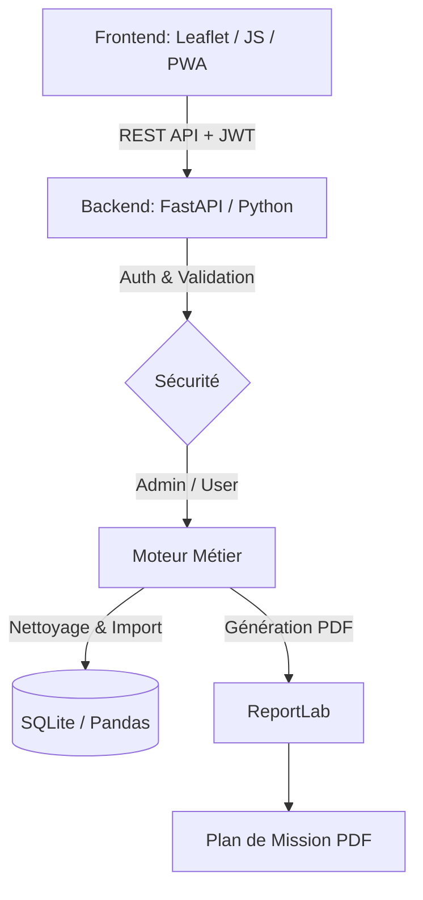

# 🚨 SantéAccès Cameroun — Crisis Room Platform

> **⚠️ Note sur le code source :** *Le code complet du backend (FastAPI) et du frontend est conservé dans un dépôt privé pour des raisons de sécurité des données de santé et de protection de la propriété intellectuelle. Ce dépôt public sert de vitrine technique (architecture, méthodologie, captures d'écran). Une démonstration complète peut être fournie sur demande lors d'un entretien.*

## 📖 Executive Summary

**SantéAccès Cameroun** est une plateforme de « Salle de crise » conçue pour les équipes humanitaires intervenant dans des zones d'urgence sanitaire.

Le premier cas d'usage ciblé est la **réponse au choléra dans le district de Minawao (Extrême-Nord, Cameroun)**. L'outil permet de centraliser les données fragmentées (alertes sanitaires, points d'eau, obstacles logistiques) pour accélérer la prise de décision et la coordination des secours sur le terrain.

## 🏗️ Architecture & Stack Technique

L'application repose sur une architecture Full-Stack moderne et sécurisée :

### 🔧 Technologies utilisées

- **Backend :** Python 3.10+, FastAPI, Uvicorn, SQLAlchemy
- **Data & Ingestion :** Pandas (nettoyage et validation des fichiers CSV), SQLite (base de données)
- **Sécurité :** Authentification par JWT (JSON Web Tokens), rôles différenciés (Admin/User)
- **Génération de documents :** ReportLab (création dynamique de plans de mission PDF)
- **Frontend :** HTML5, JavaScript (Vanilla), Leaflet.js, CSS3
- **Résilience :** Progressive Web App (PWA) avec Service Worker pour un fonctionnement hors-ligne

## ⚡ Fonctionnalités clés

- **Import de données intelligent :** téléversement de fichiers CSV. Le backend utilise Pandas pour nettoyer les données, valider les coordonnées (dans les limites du Cameroun) et détecter les doublons avant l'insertion en base.
- **Cartographie interactive (Salle de crise) :** visualisation en temps réel des alertes (suspectées/confirmées), des points d'eau en panne et des obstacles routiers sur un fond de carte sombre optimisé pour les salles d'opérations.
- **Génération de plans de mission :** création en un clic de rapports PDF incluant la carte de la zone, la liste des points d'eau à réparer et les coordonnées GPS pour les équipes terrain.
- **Mode hors-ligne (PWA) :** l'interface est conçue pour se charger et fonctionner avec une connexion Internet limitée ou instable, caractéristique des zones d'intervention.
- **Sécurité :** accès protégé par authentification. Les données sensibles ne sont visibles que par les utilisateurs autorisés.

## 📊 Impact & Cas d'usage

- **Gain de temps :** réduction du temps de préparation d'une mission (centralisation des données en un seul écran vs. compilation manuelle de multiples fichiers Excel).
- **Meilleure coordination :** permet aux coordinateurs WASH (Eau, Assainissement, Hygiène) et Santé de croiser leurs données géographiques.
- **Aide à la décision :** identification visuelle immédiate des zones où les points d'eau sont en panne à proximité des alertes sanitaires.

## 📸 Aperçu de l'application

| Salle de crise (Carte) | Génération de PDF |
|:---:|:---:|
|  |  |

## 👨‍💻 Auteur

**NDJEL DAN David Thierry**
*Ingénieur Géospatial Full-Stack & Spécialiste Humanitaire Tech*

[Portfolio](https://ton-portfolio.com) · [LinkedIn](https://www.linkedin.com/in/ton-profil)
